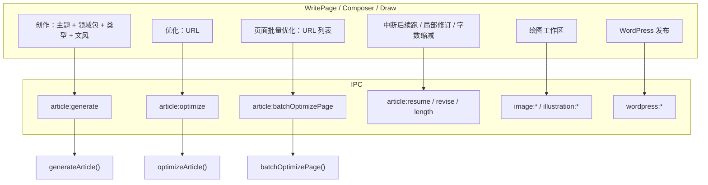
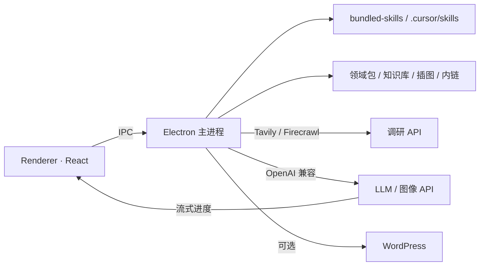

# SEO Article Generate

> **AIWriting Assistant** — 基于 Electron 的桌面应用，面向 SEO / GEO 内容生产。支持从零创作、竞品调研、分段写作、文章优化、批量优化、局部修订、插图 / 内链、WordPress 发布与 AI 痕迹检测，内置可扩展的 Cursor Agent Skills。

[](https://github.com/YieCham/seo-article-generate)

---

## 功能概览

| 能力 | 说明 |
|------|------|
| **文章创作** | 主题 → 调研 → 规划 → 大纲 → 分段撰写 → 润色 → 字数校准 → SEO Meta；支持进度看板与断点续跑 |
| **文章优化** | 提交 URL，Firecrawl 抓取后就地优化（KEEP/ADD/REMOVE），可叠加竞品调研与章节级补丁 |
| **页面批量优化** | 批量 URL，每页独立会话；仅 Firecrawl + `page-batch-optimizer`，不做 Tavily |
| **局部修订** | 选中段落追问改写，确认栏应用 / 取消 |
| **领域包** | 按领域绑定 Skill、禁词、偏好词与搜索提示（如流媒体音频、iOS 安全、通用测评） |
| **文风选择** | 创作页可选「AI 默认」或「解释性博主」（`explainer-voice`） |
| **绘图工作区** | ModeRail 切换到绘图：文生图、历史记录、插图库联动 |
| **知识库 / 插图库 / 内链库** | 可配置素材与站点内链（支持 sitemap 导入），写作与优化时可注入 |
| **WordPress 发布** | 将 Markdown 转为 HTML 并发布到站点，保留发布日志 |
| **AI 痕迹** | 扫描文稿 AI 腔并提供阅读 / 扫描结果；Humanizer 供痕迹分析使用 |
| **字数工作台** | 结构检查、缩减对话框、校准与补丁，控制篇幅与模块完整性 |
| **竞品调研** | Tavily 搜索 + Firecrawl 抓取，扩展搜索词并汇总来源 |
| **多语言输出** | 英语、中文、西班牙语、法语、德语、日语 |
| **会话管理** | 多会话、置顶 / 排序、进行中与已完成分组 |
| **LLM 预设与角色路由** | 多预设、模型发现、按 Pipeline 步骤指定模型 |
| **Token / AI Trace 日志** | 用量明细与离线分析脚本 |
| **网络代理** | 可选 HTTP(S) 代理，适配公司网络环境 |

---

## 工作区与写作模式

侧栏 **ModeRail** 可在「写作」与「绘图」之间切换。

### 写作模式

| 模式 | 说明 |
|------|------|
| **文章创作** | 从零生成；选领域包 + 文章类型（How to / Top rank / Review）+ 文风 |
| **文章优化** | 单 URL 就地优化，可联网竞品调研 |
| **页面批量优化** | 多 URL → 每页独立对话，轻量优化 |

### 文章类型与领域包

内置领域包示例：

| 领域包 | 适用格式 | 主要 Skill |
|--------|----------|------------|
| **流媒体音频** | how-to / top-rank / review | `streaming-audio-domain` + `compliance`；top-rank 另加 `seo-geo-streaming-top`；review 另加 `product-review` |
| **iOS 安全** | how-to 等 | `seo-geo-ios-security` |
| **通用测评** | review | `product-review` |

可在设置 → **领域包** 自定义绑定 Skill、禁词与搜索提示。

---

## 工作流程

各阶段进度通过 `article:progress` 推送到界面（含 **ProgressBoard**）。创作与优化支持 **checkpoint 断点续跑**、**生成后追问修改**、**字数缩减 / 校准**。

### 总体入口



### 文章创作（摘要）

1. 按领域包 / 文章类型同步 Skills（`skillPipeline` 按阶段节选注入）
2. 可选 Tavily + Firecrawl 调研 → E-E-A-T 洞察 → WritingBrief
3. 规划 → 大纲骨架 → 按 H2 分段撰写（每章可存 checkpoint）
4. 润色 → 字数校准 / 结构检查 → SEO Meta → 可选插图 / 内链
5. 终稿可进入字数工作台、AI 痕迹阅读、WordPress 发布

提示词来源与步骤说明见 [`docs/prompts/`](./docs/prompts/)。

### 文章优化（摘要）

1. Firecrawl 抓取原文并校验
2. 启用 `article-optimizer`；可选竞品调研与缺口分析
3. 原页诊断（KEEP / ADD / REMOVE）→ 锚定大纲 → 章节就地优化或全文单次优化
4. 校对、词数、SEO Meta；支持章节补丁（`optimizePatch`）

### 页面批量优化

仅抓取待优化页 + `page-batch-optimizer`，**不调用 Tavily**，每 URL 独立会话。

---

## 架构



| 层级 | 技术 | 职责 |
|------|------|------|
| **Renderer** | React 19 + TypeScript | 写作 / 绘图 / 设置、流式 Markdown、进度看板 |
| **Main** | Electron + Node | Pipeline、Skills、调研、Token / AI Trace、素材库、发布 |
| **Preload** | Context Bridge | 安全 IPC |
| **Shared** | TS 共用模块 | Markdown 规范化、领域包、内链、进度与字数工具 |

---

## 快速开始

### 环境要求

- Node.js 20+
- OpenAI 兼容 Chat Completions API Key
- （可选）Tavily / Firecrawl；图像 API；WordPress 站点凭据

### 安装与运行

```bash
git clone https://github.com/YieCham/seo-article-generate.git
cd seo-article-generate

npm install
copy .env.example .env
# 编辑 .env，填入 LLM_API_KEY（及可选调研 Key）

npm run dev
```

静默启动开发实例：`npm run dev:quiet`  
创建桌面快捷方式：`npm run shortcut:desktop`

### 打包（Windows）

```bash
npm run dist:win
```

输出至 `dist/`，NSIS 安装包产品名为 **AIWriting Assistant**。

---

## 配置说明

### 环境变量（`.env`）

| 变量 | 必填 | 说明 |
|------|------|------|
| `LLM_API_KEY` | 是 | 也可使用 `OPENAI_API_KEY` / `CURSOR_API_KEY` |
| `LLM_BASE_URL` | 否 | 默认 `https://api.openai.com/v1` |
| `LLM_MODEL` | 否 | 默认 `gpt-4o` |
| `TAVILY_API_KEY` | 否 | 竞品搜索 |
| `FIRECRAWL_API_KEY` | 否 | 网页抓取 |

应用内设置会覆盖 `.env` 中的 LLM 配置，并支持多预设。

### 应用内设置页签

| 页签 | 功能 |
|------|------|
| **LLM 配置** | 预设、模型发现、角色路由、连通性测试 |
| **Token 日志** | 各次运行用量明细 |
| **竞品调研** | Tavily / Firecrawl、区域与语言 |
| **产品配置** | 产品快捷选项、默认输出语言 |
| **提示词** | 创作 / 优化 System & User 模板 |
| **Skill 管理** | 按创作 / 优化 / 批量优化 / 文风列表启用与编辑 |
| **领域包** | 绑定 Skill、禁词、偏好词、搜索提示 |
| **知识库** | 可注入写作上下文的知识条目 |
| **插图库** | 配图素材管理 |
| **内链库** | 内链与 sitemap 导入 |
| **绘图** | 文生图 API 与参数 |
| **WordPress** | 站点凭据与发布选项 |
| **AI 痕迹** | 扫描 / 阅读配置 |
| **通用** | 窗口关闭（退出 / 托盘）、网络代理等 |

写作页可为**当前会话**选择预设与模型。

---

## 内置 Skills

开发时：`.cursor/skills/`；打包：`src/main/bundled-skills/`。

| Skill ID | 用途 |
|----------|------|
| `streaming-audio-domain` | 流媒体音频领域知识、关键词、E-E-A-T |
| `streaming-audio-compliance` | 合规禁词与免责声明 |
| `seo-geo-streaming-audio` | 兼容壳（已拆分，勿单独依赖） |
| `seo-geo-streaming-top` | Top 榜单结构与写法 |
| `seo-geo-ios-security` | iOS 安全类 SEO/GEO |
| `product-review` | 产品测评 / 对比 |
| `article-optimizer` | 单页就地优化 |
| `page-batch-optimizer` | 批量页优化（无联网竞品） |
| `explainer-voice` | 解释性博主文风（创作页下拉） |
| `humanizer` | 去 AI 味规范（供 AI 痕迹等场景） |

结构 / 字数 / 产品植入等硬规则多在 `src/main/agent/*.ts` 代码常量中，由 `skillPipeline.ts` 按步骤注入 Skill 节选。详见 [`docs/prompts/`](./docs/prompts/)。

---

## 常用命令

| 命令 | 说明 |
|------|------|
| `npm run dev` | 开发模式 |
| `npm run dev:quiet` | 隐藏窗口启动开发实例 |
| `npm run build` | 构建 |
| `npm run preview` | 预览构建结果 |
| `npm run typecheck` | TypeScript 检查 |
| `npm run dist:win` | Windows 安装包 |
| `npm run shortcut:desktop` | 创建桌面快捷方式 |

```bash
node scripts/analyze-token-usage.mjs
node scripts/analyze-optimize-session.mjs
```

---

## 项目结构

```
seo-article-generate/
├── .cursor/skills/           # 开发时 Skills
├── docs/prompts/             # 提示词总览与白话说明
├── icons/                    # 应用与 UI / LLM 品牌图标
├── scripts/                  # 分析脚本、快捷方式、静默启动
├── src/
│   ├── main/
│   │   ├── agent/            # 创作 / 优化 / 修订 / 字数 / 内链 / 插图 Pipeline
│   │   ├── aiTrace/          # AI 痕迹扫描与阅读
│   │   ├── config/           # 配置与角色路由
│   │   ├── domainPack/       # 领域包存储
│   │   ├── illustration/     # 插图库
│   │   ├── image/            # 绘图历史
│   │   ├── internalLink/     # 内链与 sitemap
│   │   ├── knowledge/        # 知识库
│   │   ├── research/         # Tavily / Firecrawl
│   │   ├── token/            # Token 用量
│   │   ├── wordpress/        # 发布客户端与日志
│   │   ├── window/           # 托盘
│   │   ├── net/              # 代理运行时
│   │   └── bundled-skills/   # 打包内置 Skills
│   ├── preload/
│   ├── renderer/src/         # React UI（Write / Draw / Settings）
│   └── shared/               # 共用类型与 Markdown / 进度 / 字数工具
├── .env.example
├── electron.vite.config.ts
└── package.json
```

---

## 技术栈

- **Electron** 35 — 桌面壳
- **electron-vite** — 主进程 / preload / 渲染进程构建
- **React** 19 + **TypeScript**
- **react-markdown** + **remark-gfm**
- **undici** — 网络请求（含代理场景）
- **electron-builder** — Windows NSIS 打包

---

## 更新要点（相对早期版本）

- 领域包驱动 Skill 绑定，替代「仅按文章类型硬编码」的单一路径
- 绘图工作区、插图库、知识库、内链库、WordPress 发布
- LLM 角色路由、会话级模型、AI 痕迹与字数工作台 / 进度看板
- 章节级优化补丁、结构检查、改写守卫与 Markdown 规范化增强
- 文风 `explainer-voice`；Humanizer 用于痕迹分析（创作润色策略以当前代码为准）
- 网络代理、托盘关闭行为、提示词文档目录

---

## 许可证

本项目为私有 / 内部工具。使用前请遵守所用 LLM、图像、Tavily、Firecrawl、WordPress 等服务的条款。

---

## 相关链接

- **GitHub**：https://github.com/YieCham/seo-article-generate
- **提示词文档**：[`docs/prompts/`](./docs/prompts/)
